# Experiment 4 – Form Validation using Stateful Widgets

**Application:** Car Mileage Calculator 🚗

## Aim
Design and implement a Car Mileage Calculator using Flutter Forms, TextFormField,
Input Widgets and Stateful Widgets. Validate user inputs and display the
calculated mileage dynamically.

## Formula and classification (from the Experiment 4 reference PDF)

```
Mileage (km/l) = Distance Travelled (km) / Fuel Consumed (litres)
```

| Mileage            | Classification       |
|--------------------|----------------------|
| below 10 km/l      | Poor Efficiency      |
| 10 to 15 km/l      | Average Efficiency   |
| above 15 km/l      | Excellent Efficiency |

## Flutter concepts demonstrated
`MaterialApp`, `Scaffold`, `AppBar`, `StatefulWidget`, `setState()`, `Form`,
`GlobalKey<FormState>`, `TextFormField`, `TextEditingController`,
`InputDecoration`, `TextInputType`, `ElevatedButton`, `Card`, `Container`,
`Row`, `Column`, `Padding`, `SingleChildScrollView`.
The full implementation is in [`lib/main.dart`](lib/main.dart), with comments for the viva.

## Validation rules

| Field     | Empty                               | Not a number            | Zero / negative                          |
|-----------|-------------------------------------|-------------------------|------------------------------------------|
| Distance  | Please enter distance travelled.    | Enter a valid number.   | Distance must be greater than 0.         |
| Fuel      | Please enter fuel consumed.         | Enter a valid number.   | Fuel consumed must be greater than 0.    |

## Project structure

```
flutter-experiment-4-form-validation-stateful-widgets/
├── .github/workflows/deploy.yml   # GitHub Pages deployment (GitHub Actions)
├── android/
├── ios/
├── lib/
│   └── main.dart                  # complete application
├── screenshots/                   # actual output screenshots
├── test/
│   └── widget_test.dart           # automated tests for all 8 test cases
├── web/
│   ├── flutter_bootstrap.js       # loads bundled CanvasKit (no CDN needed)
│   ├── index.html
│   └── manifest.json
├── .gitignore
├── analysis_options.yaml
├── pubspec.yaml
└── README.md
```

## How to run

```bash
flutter pub get
```

```bash
flutter analyze
```

```bash
flutter test
```

```bash
flutter run -d chrome
```

## Test results

| # | Input                          | Expected                                | Result |
|---|--------------------------------|-----------------------------------------|--------|
| 1 | empty / empty                  | both "Please enter …" messages          | ✅ |
| 2 | `abc` / `xyz`                  | "Enter a valid number." on both fields  | ✅ |
| 3 | `0` / `-5`                     | greater-than-zero messages              | ✅ |
| 4 | `300` / `20`                   | 15.00 km/l – Average Efficiency         | ✅ |
| 5 | `125.5` / `10`                 | 12.55 km/l – Average Efficiency         | ✅ |
| 6 | `180` / `20`                   | 9.00 km/l – Poor Efficiency             | ✅ |
| 7 | `400` / `20`                   | 20.00 km/l – Excellent Efficiency       | ✅ |
| 8 | Clear button                   | fields, errors and result card reset    | ✅ |

## Output screenshots

| Initial | Test 1 – Empty | Test 2 – Invalid |
|---|---|---|
| 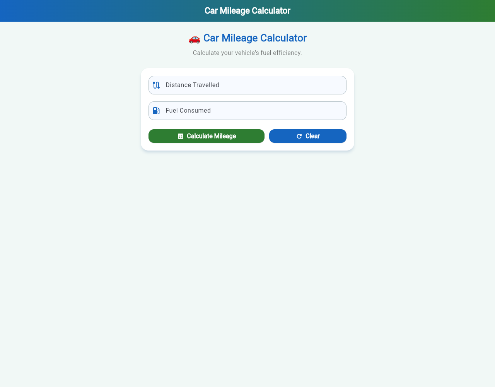 | 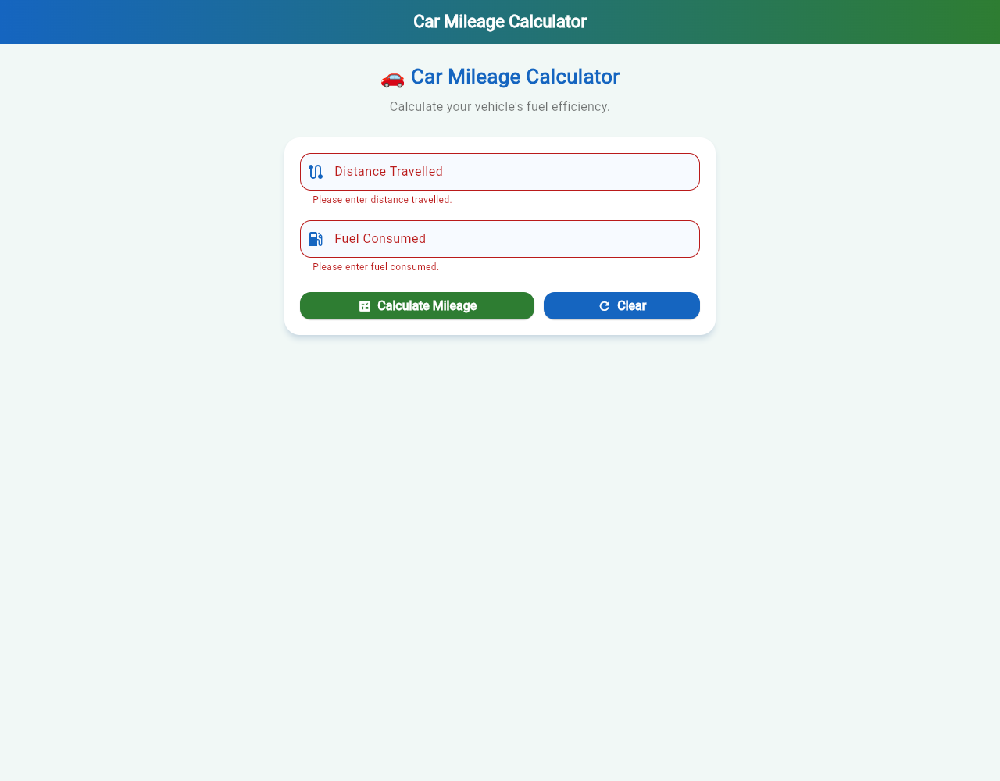 | 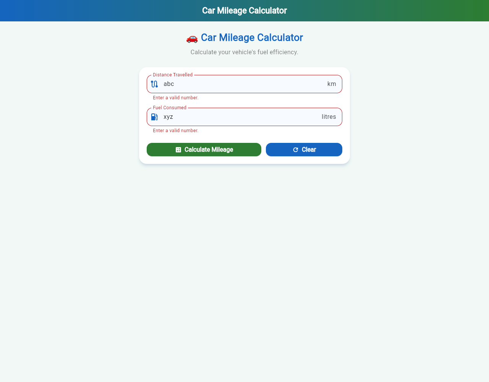 |

| Test 3 – Zero/negative | Test 4 – 15.00 Average | Test 5 – 12.55 Average |
|---|---|---|
| 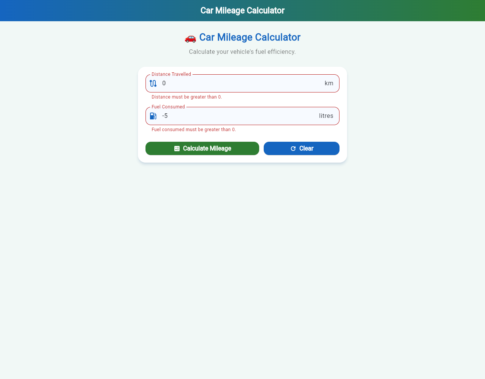 | 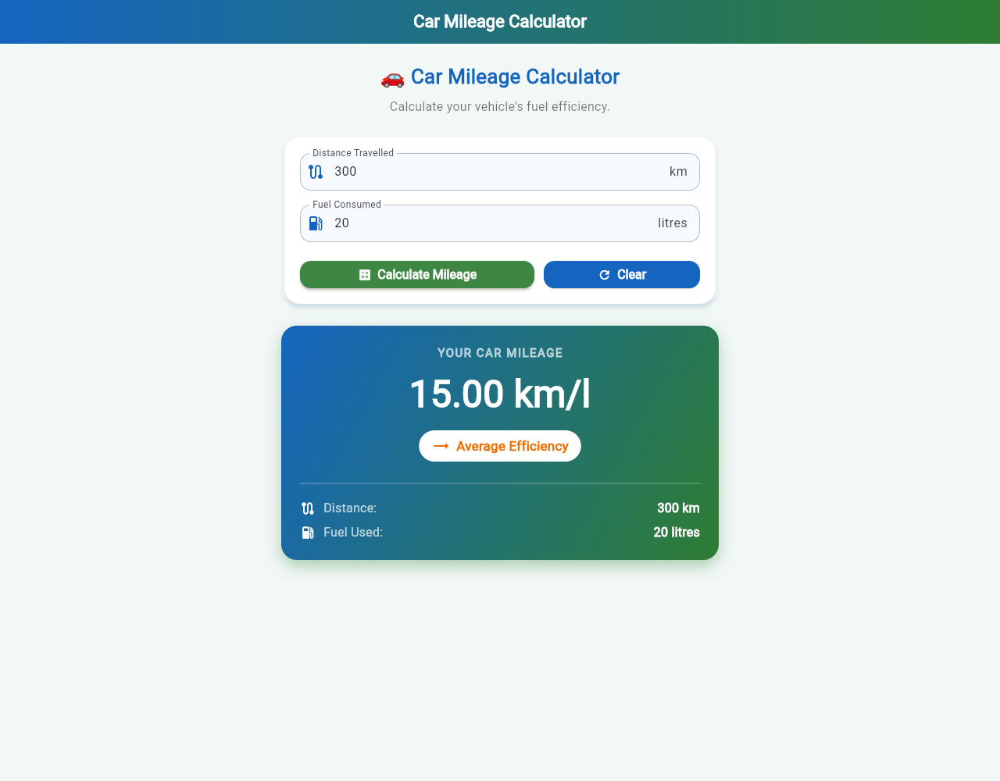 | 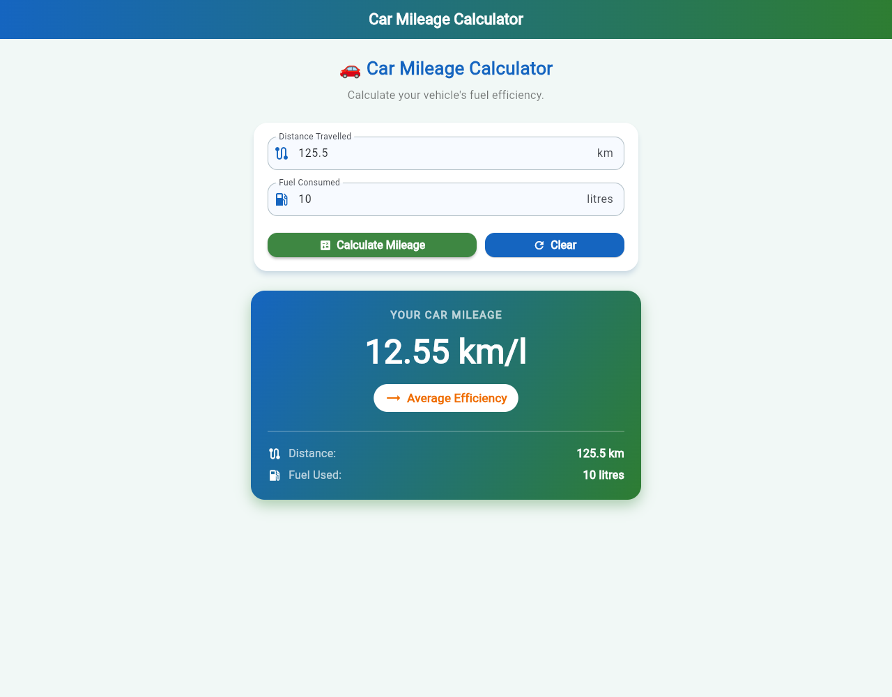 |

| Test 6 – 9.00 Poor | Test 7 – 20.00 Excellent | Test 8 – Cleared |
|---|---|---|
| 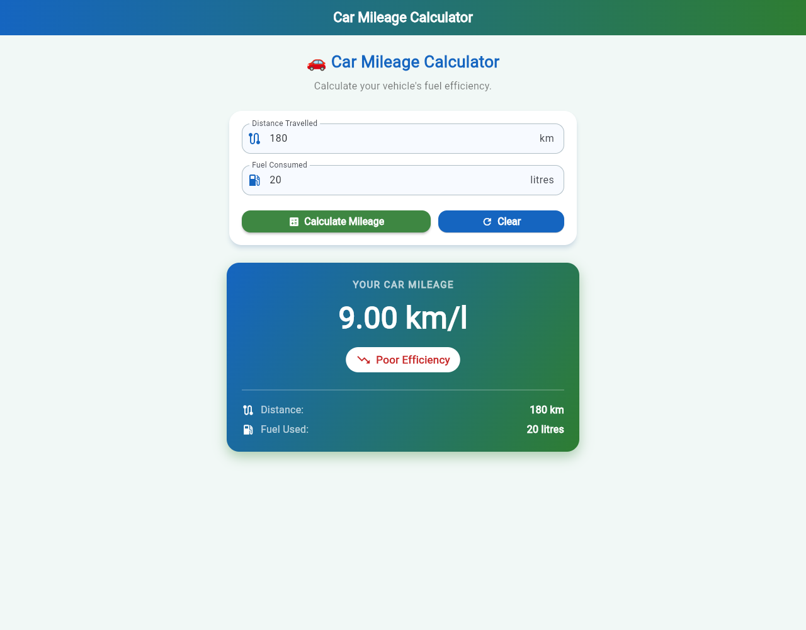 | 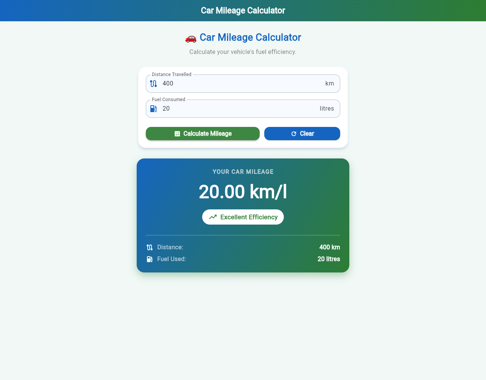 | 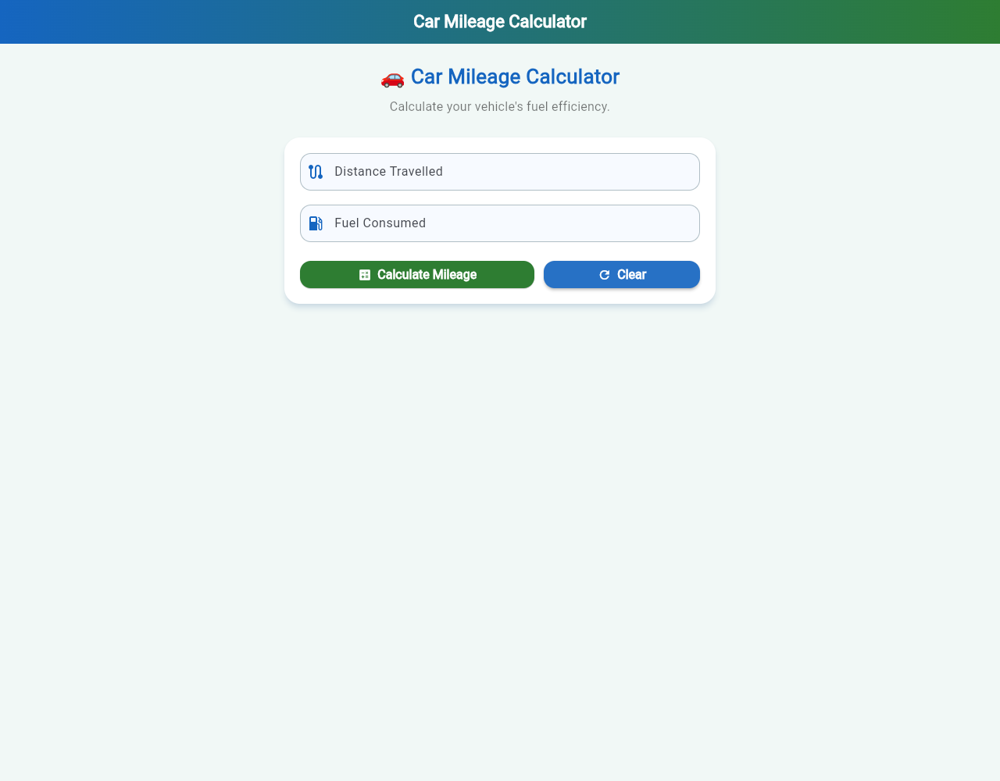 |

| Mobile (375 px) | Tablet (820 px) |
|---|---|
| 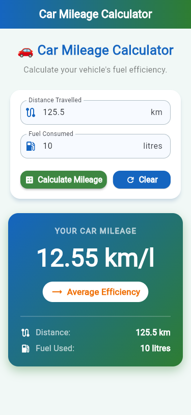 | 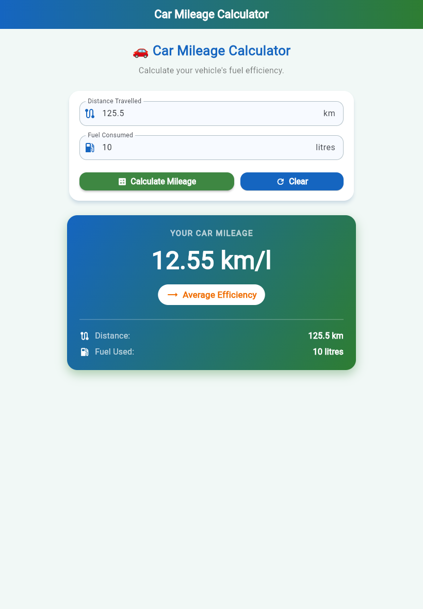 |

## Web build

```bash
flutter build web --release --base-href "/flutter-experiment-4-form-validation-stateful-widgets/"
```

The output is generated in `build/web/`.

## Upload to GitHub

1. Create an empty public repository named
   `flutter-experiment-4-form-validation-stateful-widgets` under the
   `yokeshwaran7` account (do not add a README).
2. From inside this project folder, run:

```bash
git init
```

```bash
git add .
```

```bash
git commit -m "Experiment 4: Car Mileage Calculator"
```

```bash
git branch -M main
```

```bash
git remote add origin https://github.com/yokeshwaran7/flutter-experiment-4-form-validation-stateful-widgets.git
```

```bash
git push -u origin main
```

## Deploy to GitHub Pages

1. In the repository, open **Settings → Pages**.
2. Under **Build and deployment → Source**, choose **GitHub Actions**.
3. The included workflow `.github/workflows/deploy.yml` runs on every push to
   `main`. It analyzes, tests, builds and deploys the app. Track it under the
   **Actions** tab, or start it manually with **Run workflow**.
4. When the run turns green, the app is live at:
   https://yokeshwaran7.github.io/flutter-experiment-4-form-validation-stateful-widgets/
